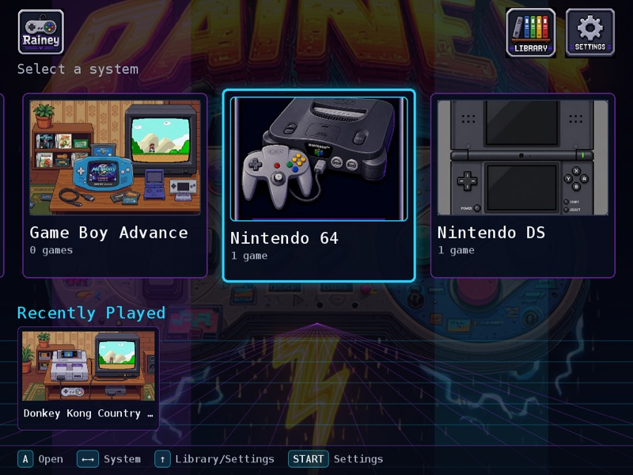
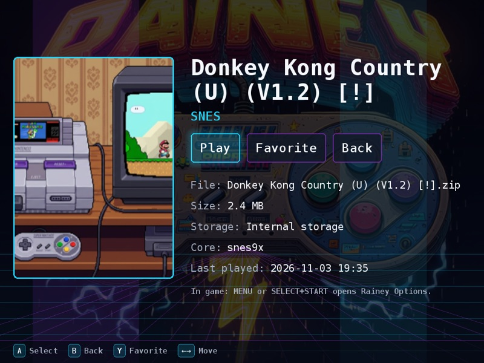
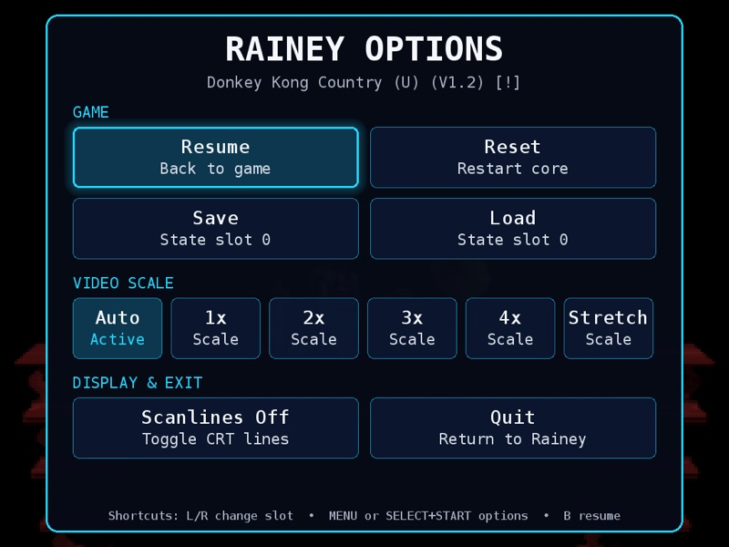
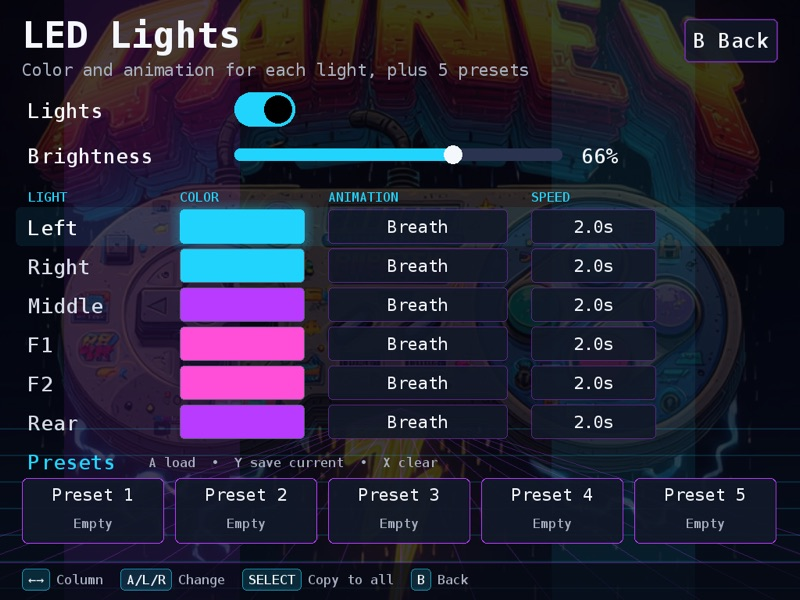
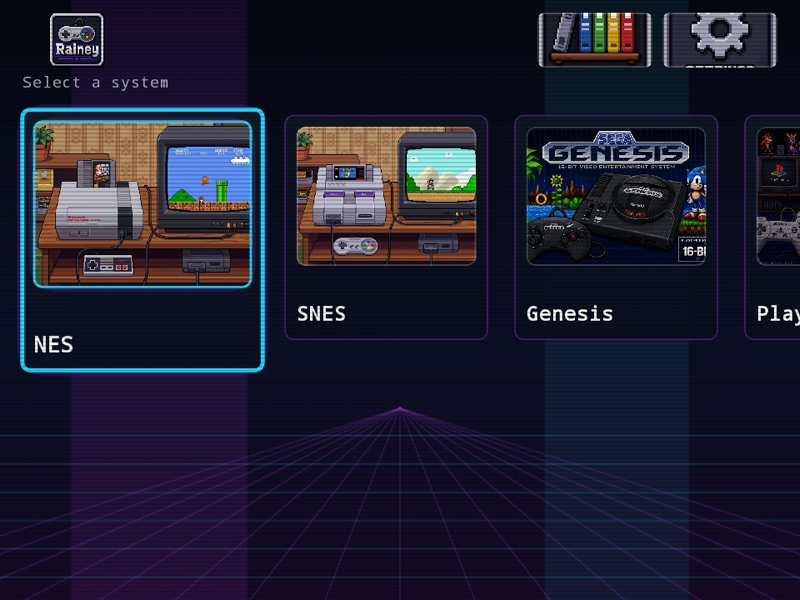
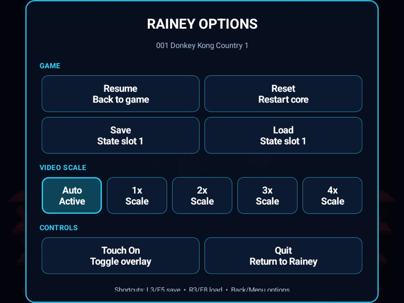

# RaineyUI

A neon-arcade retro gaming frontend, in two versions:

| | **TrimUI** (Brick / Smart Pro) | **Android** |
| --- | --- | --- |
| Runs on | TrimUI Brick / Smart Pro, stock firmware | Android 12+ arm64 handhelds, TV boxes (Orange Pi 5, RG406V…) |
| Built with | C + SDL2, built-in libretro player | Kotlin + Jetpack Compose, LibretroDroid |
| Source | [`trimui/`](trimui/) | [`app/`](app/), [`libretrodroid/`](libretrodroid/) |
| Docs | [trimui/README.md](trimui/README.md) | [README-Android.md](README-Android.md) |

RaineyUI is a launcher and library manager. **It does not include games, BIOS files or
copyrighted artwork.** Use only games and BIOS files you are legally allowed to use.

## TrimUI version

<p>
 
 
</p>

- Home carousel, recently played, library grid/list, game details, favorites
- Built-in libretro player with the *Rainey Options* menu (save/load states, video scale, scanlines)
- NES, SNES, Genesis / Master System / Game Gear, PlayStation, Arcade / Neo Geo, Game Boy / Color,
  Game Boy Advance (built-in player); Nintendo 64 and Dreamcast (RetroArch); Nintendo DS (DraStic)
- Reads SD cards as-is, including EmulationStation / Batocera / Anbernic folder layouts and their box art
- LED lights: color + animation per light, 5 presets
- Selectable menu backgrounds (static or animated, or your own pictures)
- Wi-Fi transfer page and a *Send to Brick* drag-and-drop Mac app; files are sorted automatically

### Install

1. Download `RaineyUI-TrimUI-<version>.zip` from [Releases](../../releases) and unzip it.
2. Connect the Brick to your computer with USB (ADB on), with
   [adb](https://developer.android.com/tools/releases/platform-tools), `python3` and `curl` installed.
3. Run `./install.sh`. It copies RaineyUI to internal storage and downloads the emulators from their
   original projects (libretro buildbot, [CrossMix-OS](https://github.com/cizia64/CrossMix-OS)).
4. On the Brick: **Apps → RaineyUI**.

Optional: `Send-to-Brick-mac.zip` from Releases is a drag-and-drop app for copying games over USB.

## Android version

<p>
 
</p>

Download the APK from [Releases](../../releases) and install it (`adb install -r <apk>`), or build it:
see [README-Android.md](README-Android.md).

## Building

- **TrimUI:** `trimui/build.sh` cross-compiles with [zig 0.13](https://ziglang.org/download/)
  (aarch64, glibc 2.33); `trimui/deploy.sh --full --run` builds, installs and launches it.
  Details in [trimui/README.md](trimui/README.md).
- **Android:** `tools/fetch_android_cores.sh`, then `./gradlew assembleDebug`.
- **Mac desktop launcher (experimental):** see [desktop/README.md](desktop/README.md).

## Repository layout

```
app/, libretrodroid/      Android app and its native libretro runtime (LibretroDroid, GPL-3.0)
trimui/src/               TrimUI frontend + libretro player (C, SDL2)
trimui/package/RaineyUI/  TrimUI app folder (launch scripts, art, fonts, backgrounds)
trimui/tools/             emulator installer, core glibc patcher
trimui/mac/               Send to Brick (macOS droplet) source
desktop/                  experimental macOS launcher
assets/, screenshots/     artwork and screenshots
```

Third-party components and their licenses: [THIRD_PARTY_NOTICES.md](THIRD_PARTY_NOTICES.md).
